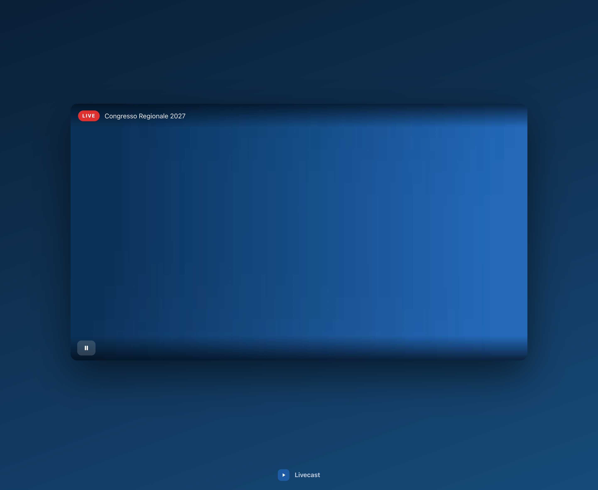
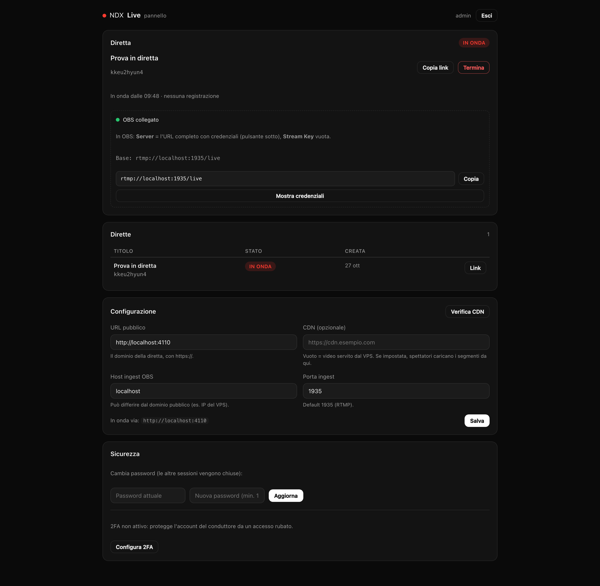

# Livecast

**Self-hostable live audio/video streaming.** A small team broadcasts from OBS;
the audience gets a shareable link and a player with play and pause. Adaptive
HLS for video, a clean audio-only mode, and a control plane small enough to read
in an afternoon — running on a €8 VPS until the audience justifies a CDN.

Fork it, rename it, set your own name in the panel: nothing here is tied to a
vendor, a domain or an organisation.

Built as the streaming layer for the maintainers events. The driving constraint was not
features: it was *"the transmission must not fall during the event"* — so the
code is organised around failure, not around convenience. See
[`docs/ARCHITECTURE.md`](docs/ARCHITECTURE.md#redundancy-what-holds-when-things-break.md).



*Both screenshots are captures of a live broadcast on production
(`https://live.example.com`), taken by Playwright through a real Chrome instance.*

```
 OBS ──RTMP:1935──▶ MediaMTX (ingest, loopback-only readers)
                         │
                         ▼
                    FFmpeg ──▶ 720p / 480p / 360p HLS ──▶ nginx ──▶ Bunny/Cloudflare CDN (optional)
                         │                          │
                    watchdog                        └──▶ player  /live/<slug>
                         │
                Fastify + SQLite (panel, sessions, settings)
```

## Why this and not a managed player

| Decision | Why |
| --- | --- |
| **HLS, not WebRTC** | 4,000 concurrent viewers at 2 Mbps is 8 Gbps; no SFU fits that on one VPS. HLS behind a CDN does, cheaply. "Light delay" (~8–12 s) was the accepted trade. |
| **MediaMTX for ingest only** | It accepts RTMP and enforces the stream key. The video itself is encoded by FFmpeg into a plain directory of files — the easiest thing to inspect, restart, and put behind a CDN. |
| **Play/pause only, on purpose** | A live stream has no timeline to seek. Every extra control is another thing that can be wrong on a phone in a crowd. |
| **No PIN on the link** | By decision: an open transmission. The slug is random and unindexed, which keeps it out of search results without pretending it is access control. |
| **Two kinds of broadcast** | Video (720/480/360 ladder) and audio-only (128 kbps AAC) share the same pipeline; the audio mode drops any video the publisher sends instead of paying for an encoder chain nobody watches. |
| **Users, not just an account** | One admin manages accounts; operators can run broadcasts. The admin account itself cannot be deleted or have its password reset by anyone else. |
| **SQLite** | One operator, a handful of streams. A database server would be a process to keep alive for no benefit. |

## Quick start (local)

```bash
pnpm install
cp infra/env.example .env          # edit PUBLISH_PASS + MEDIAMTX_READ_* if you run a media server
pnpm dev:api                        # Fastify on :4100, serves the built player if present
pnpm dev:web                        # Vite on :5173, proxying /api and /hls to :4100
```

Create the admin account:

```bash
pnpm cli create-admin --username admin
# prints ADMIN_PASSWORD=... once
```

A full local broadcast also needs a local MediaMTX (ingest) — or simply run the
provisioning below on a VPS. The FFmpeg ladder itself is covered by a smoke
script in [`docs/RUNBOOK.md`](docs/RUNBOOK.md#verifying-the-encoder).

## Deploy on a VPS

Requirements: Ubuntu LTS, Node.js ≥ 22, nginx + certbot, a DNS **A record** for
the chosen hostname already pointing at the VPS, and SSH key access as root.

```bash
# first install: syncs the source, provisions MediaMTX + systemd + nginx + TLS
bash infra/scripts/deploy.sh --provision

# every release afterwards
bash infra/scripts/deploy.sh
```

Both scripts are idempotent. The deploy prints the generated admin password once
and stores it in `/root/.livecast-credentials` on the server.

Then: open `https://<domain>/admin`, log in, and copy the RTMP URL the panel
shows into **OBS → Settings → Stream → Server** (stream key left empty). Create
a broadcast from the panel and press play on `/live/<slug>`.

## The panel in one screen



- **Diretta** — create a broadcast, "Crea e vai in onda", stop it, and copy the
  public link. OBS credentials are masked until revealed (the reveal is audited).
- **Dirette** — previous broadcasts with their kind (video / audio-only); each
  row keeps its link. Deleted rows never own files on disk.
- **Utenti** (admin only) — create operators, reset their passwords, delete them.
  The admin account row shows "account protetto" and has no actions.
- **Configurazione** — public URL, **CDN base URL, ingest host/port**: switching
  delivery to a CDN is a URL and a click, no redeploy. "Verifica CDN" probes the
  live manifest through the CDN edge and reports the cache header it saw. The
  step-by-step attach procedure is [`docs/CDN.md`](docs/CDN.md).
- **Sicurezza** — change your own password (revokes your other sessions).

## Make it yours

- **Name** — Configurazione → *Nome dell'installazione*. It appears in the panel,
  the player and the page title; no rebuild needed.
- **Colours** — the palette lives in `apps/web/src/styles.css` (`:root` tokens).
  The light theme and the dark player are two gradients and a handful of
  variables, not a framework.
- **Install name** — `APP_NAME=yourname bash infra/scripts/deploy.sh --provision`
  sets the service user, directory and systemd units for a fresh server.
- **Repo** — rename it freely; the only files that mention "livecast" are the
  package names, the default `APP_NAME`, and the fallback brand string.

## Configuration

| Variable | Default | Purpose |
| --- | --- | --- |
| `PORT` / `HOST` | `4100` / `127.0.0.1` | Fastify listener behind nginx. |
| `DATA_DIR` | `./data` | SQLite database, HLS output, recordings. |
| `PUBLIC_URL` | `http://localhost:4100` | Canonical origin: page links and the Origin check. |
| `INGEST_HOST` / `INGEST_PORT` | host from `PUBLIC_URL` / `1935` | What OBS connects to (editable at runtime in the panel). |
| `PUBLISH_USER` / `PUBLISH_PASS` | `publisher` / — | Broadcaster credentials shown in the panel, enforced by MediaMTX. |
| `MEDIAMTX_READ_USER` / `_PASS` | — | Loopback credentials FFmpeg uses to read the stream. |
| `COOKIE_SECURE` | `false` in dev, `true` in production | Session cookies over TLS only. |
| `INGEST_WAIT_SECONDS` | `600` | How long a stream waits for OBS before ending itself. |
| `BRAND_NAME` | `Livecast` | Display name until one is saved in the panel. |

Runtime settings (public URL, CDN, ingest host/port) live in the database,
seeded from `PUBLIC_URL`/`INGEST_*` on first boot and editable from the panel.

## Capacity: when the VPS is enough, and when it is not

| Audience | What you need |
| --- | --- |
| **up to ~500 viewers** | The VPS alone. 500 × ~2 Mbps ≈ 1 Gbps is already the practical limit of one machine's port, so stay comfortably under it. |
| **500 – 50,000** | A CDN pull zone in front of `/hls/*`. The origin then serves each segment once per edge, not once per viewer. Set the CDN URL in the panel and watch the LED turn green. |
| **thousands, one event** | The panel warns when no CDN is configured: it is the one setting that decides whether an event survives its own audience. |

The number is not a promise about one specific VPS: it is the arithmetic
(viewers × bitrate versus the server's network port). The panel shows the live
capacity hint and the CDN state, so the operator never has to remember it.

## What holds when things break

The event-day guarantees are documented as a table in
[`docs/ARCHITECTURE.md`](docs/ARCHITECTURE.md#redundancy-what-holds-when-things-break.md),
and the operator runbook (go-live checklist, CDN attach, troubleshooting) is
[`docs/RUNBOOK.md`](docs/RUNBOOK.md). Short version:

| Failure | What recovers it |
| --- | --- |
| OBS disconnects / laptop sleeps | FFmpeg exits, the supervisor relaunches it in < 3 s, the publisher reconnects when it can |
| Encoder hangs with an open socket | Watchdog: 2 minutes of unchanged segments ⇒ SIGKILL + relaunch, stream stays live |
| Media server crashes | systemd restarts it in 2 s; the broadcast resumes on OBS reconnect |
| API crashes | systemd restarts it; the player keeps its last segments and the page polls |
| Event-size audience | CDN base URL in the panel — segments are immutable and cache for a year |

## If the server itself dies

No process supervision saves a machine. Losing the VPS means losing the encoder
and the origin at once — the CDN can keep serving the last cached segments for a
few seconds, and then everyone sees "signal unavailable". That is the honest
limit of a single-box install, and it needs a plan, not a promise:

1. **Standby VPS, same code** — provision a second server with the same
   `APP_NAME` and `APP_DOMAIN`, copy `DATA_DIR` (it is one directory) and the
   `.env`, and keep the DNS record at a low TTL (300 s). Re-pointing DNS is the
   whole failover: the same database, credentials and settings come back.
2. **CDN origin failover** — a CDN that supports multiple origins/fallback
   zones can switch to the standby origin without DNS changes.
3. **Publisher-side redundancy** — the primary/backup publish paths cover the
   other half of the equation: if the *encoder* fails, the show continues; if
   the *server* fails, no software on it can. The two failures are independent.

## Tests

```bash
pnpm typecheck        # tsc, both packages
pnpm test             # 32 tests: FFmpeg args (video + audio), supervisor, auth, users, routes
pnpm build            # api → dist, web → dist
```

The FFmpeg argument list is asserted in tests and exercised end-to-end by a real
encoder smoke script, because the flags are the part of this system most likely
to rot silently.

The player itself was verified in Chromium through Playwright against a real
MediaMTX → FFmpeg → HLS chain: the LIVE badge renders, pressing play moves
`video.currentTime` forward with no console errors, the single control toggles
pause and resume, and the same flow was captured on a 390 px mobile viewport
([`docs/screenshots/player-mobile.png`](docs/screenshots/player-mobile.png)).

## Layout

```
apps/api     Fastify + better-sqlite3: auth, streams, encoder supervisor, settings
apps/web     React + Vite: landing, login, panel, player (hls.js loaded on demand)
infra        MediaMTX config template, systemd units, nginx sites, provision/deploy scripts
docs         Architecture decisions, operator runbook
```

## License

MIT — see [`LICENSE`](LICENSE).

---

*Built by [Simone D'Agostino](https://github.com/sdagostino777) for the maintainers.*
